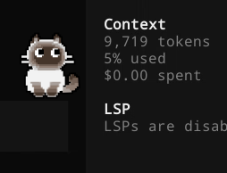

# Kiri



An animated character that lives on your desktop and doubles as a spatial AI
assistant — drop the character onto anything on screen and it understands the
region underneath, then summarizes, solves, explains, translates, or runs a
task you defined. It can see your screen, talk back out loud, hold a real
conversation, generate documents and spreadsheets, run things on a schedule, and
remember what it taught you. Pick a Ghibli-resembling character or design your
own.

## Features

### The character

- **Living animations** — the character idles with cursor-tracking eyes and
  leans toward your pointer, then reacts to what's happening: dangling by the
  scruff while you drag it (side view when you swing it sideways), perking up
  when it **listens**, scribbling in a notepad while an AI agent **works**, and
  beaming when a task or pomodoro is **done**. When it shows you something on
  screen it looks there while an arrow marks the spot.
- **Characters** — pick Kiri or Tori, paint your own look in the pixel overlay
  editor, and run several at once, each with its own name, look, and personality.
- **Desktop companion** — follows your cursor, plus a pomodoro timer,
  time/interval reminders and an optional stretch reminder.

### Seeing your screen

- **Spatial AI** — drop the character onto text, a question, code, or an image
  and it captures that region, understands it with a vision model, and runs a
  task: 📝 summarize, ✅ solve, 💡 explain, 🌐 translate, 📋 extract, or your own.
- **Ask about my screen** — hold the push-to-talk hotkey (default Ctrl+Alt) and
  ask out loud, or right-click → **Ask about my screen…** and type it. The answer
  **streams** into the speech bubble word by word, pointing at the spot with a 🐾
  when it helps. Typed mode needs no OpenAI key, so it works on local Ollama too.
- **Ask about a region** — right-click → **Ask about a region…**, drag a box
  around exactly what you mean, type your question, and it answers about just
  that selection (spotlight overlay, pointing 🐾, spoken reply).
- **App awareness** — answers know which app you're in (name only, e.g. "VS
  Code") so they're sharper. macOS-only, no extra permission; toggle in settings.

### Talking with it

- **Voice commands (STT)** — a mic button: click, speak, and the command runs.
- **Spoken answers (TTS)** — the character reads screen answers aloud, using
  OpenAI voices when a key is set or the built-in macOS voice for your language
  (offline, keyless). Volume follows the notification-sound slider.
- **Chat window** — right-click → **Chat with Kiri…** for a real back-and-forth
  conversation that remembers the thread (and the character's memory). Streams,
  supports multiple turns, per-character sessions.

### Getting things done

- **Command agent** — "make a 5-slide presentation about X and save it" →
  approval card → a real file under `~/Documents/Kiri/`, with a 30-second undo.
  Generates `.pptx`, `.docx`, `.xlsx` (real formatted spreadsheets), `.csv`,
  `.json`, and text/markdown/html. Ships with starter skills (report table,
  meeting notes, summary doc, slide deck, CSV) and lets you teach your own in
  plain language.
- **Automations** — schedule a prompt on an interval or a daily time: a **note**
  the character speaks, or a **screen check** that looks at your screen and
  answers (bubble + 🐾 + spoken). Right-click → **Tasks ▸ Automations…**.
- **Knowledge Journal** — save what the character solved/explained as flashcards
  and review them on an SM-2 spaced-repetition schedule.
- **Per-character memory** — each character keeps its own history of the work it
  did (summaries, screen answers, files it made, chats) in a readable `.md`, and
  feeds recent entries back as context — so it remembers across restarts. Right-
  click → **🧠 Memory** to view, edit, or clear it.

### Setup & control

- **Quick profiles** — one click flips the whole stack: **Local** (offline
  Ollama brain + built-in voice), **Fast** (small cloud model, no voice), or
  **Quality** (flagship model + full voice). Fine-tune anything afterwards.
- **Multi-provider** — Claude (Anthropic), OpenAI (GPT-4o), Google Gemini, or
  **Ollama** (fully local / offline / free).
- **Control bridge** — a local token-guarded HTTP server (`127.0.0.1:23456`)
  lets external agents/tools drive the pet: report agent state, ask what it can
  do (`/status`), make it `/speak`, or `/point` at a screen spot (the pet looks
  there and an arrow marks it).
- **Community pets** — Kiri reads the petdex / agentpets sprite-sheet format
  (`pet.json` + an 8×9 grid sheet). Anything installed with
  `npx petdex install <slug>` (or dropped into `~/.kiri/pets/`) shows up under
  right-click ▸ **Add character**, animates from the sheet, and follows Kiri's
  states (idle / waving when clicked / running while an agent works). Kiri only
  reads what you installed — it ships just its own original characters.
- **MCP server** — the same bridge, exposed to any MCP client (Claude Code,
  Cursor, …) as five tools: `kiri_status`, `kiri_say`, `kiri_point`,
  `kiri_react`, and `kiri_ask_screen` (the agent borrows Kiri's eyes: it asks
  about the user's screen and gets the answer back, while the user sees it in
  the speech bubble). It registers itself while agent monitoring is on (and removes
  itself when you turn it off), and runs on Kiri's own bundled Node runtime — no
  system `node` required. Text an agent sends is scrubbed of secrets and
  absolute paths before it reaches a speech bubble.
- **Multi-language UI** — English, Türkçe, 한국어, 日本語 (every window and menu).

## Stack

- [Electron](https://www.electronjs.org/) (main + renderer + editor windows)
- `@anthropic-ai/sdk` + OpenAI-compatible HTTP for the LLM providers (Anthropic
  native SDK; OpenAI / Gemini / Ollama share one chat-completions client)
- `pptxgenjs` / `docx` / `exceljs` for document & spreadsheet generation
- `uiohook-napi` for global keyboard / wheel hooks
- OpenAI HTTP for speech-to-text and text-to-speech (with a macOS `say` fallback)
- `electron-builder` for packaged builds

## Quick start

```bash
cd kiri
npm install
npm start
```

Open the character's right-click menu → **🐾 AI Assistant…** to enable AI and
enter a provider key (or pick Ollama for a fully local, no-key setup).

To keep your API keys off this machine, deploy
[kiiri-proxy](https://github.com/kiiri-app/kiiri-proxy) to your Cloudflare account
and pick **Your own proxy** as the provider. Chat, screen questions and voice
then all go through it, and the app only stores a proxy token.

### Other scripts

| Script | What it does |
| --- | --- |
| `npm start` | Run the app in dev mode. |
| `npm test` | Unit tests (Node's built-in runner, no Electron needed). |
| `npm run check` | Syntax-check every JS file. |
| `npm run smoke` | Boot the app, log a startup line, and quit (CI smoke test). |
| `npm run pack` | Build an unpacked, ad-hoc signed app into `dist/`. |
| `npm run build:poses` | Rebuild the kiri/tori sprite strips from `art/src/`. |
| `npm run dist` | Build installable artifacts for the current OS. |
| `npm run dist:win` / `dist:mac` / `dist:linux` | Per-OS installers. |

## Privacy

- Screenshots stay in memory only and are never written to disk.
- API keys are stored encrypted (Electron `safeStorage`) and only read by the
  main process — never exposed to the renderer.
- File output is sandboxed to `~/Documents/Kiri/`; every write is approved and
  undoable.
- App awareness sends only the frontmost app's **name** (never window contents),
  needs no extra permission, and can be turned off in settings.
- The control bridge is bound to `127.0.0.1` and requires a per-machine token;
  an agent asking Kiri to look at your screen needs your OK each time (or once
  per session).
- With the Ollama provider, everything runs locally with no network calls.

## Permissions & platform notes

- Nothing is required up front; the first-run welcome explains each permission.
- **macOS** — asking about your screen needs **Screen Recording**; voice needs
  **Microphone**; hold-to-talk needs **Accessibility** (and sometimes **Input
  Monitoring**) — the global key hook only runs while hold-to-talk is on.
- **Windows** — security software can block the global hook; allow it if
  hold-to-talk never triggers.
- **Linux** — global keyboard hooks may need extra udev rules on some distros.

## Docs

- [`AI-ASSISTANT.md`](AI-ASSISTANT.md) — the AI features in detail.
- [`AI-ROADMAP.md`](AI-ROADMAP.md) — design notes and roadmap.
- [`RELEASING.md`](RELEASING.md) — tests, packaging, signing and auto-update.

## License

MIT — see [`License.md`](./License.md). © 2026 Ahmet Vural.
